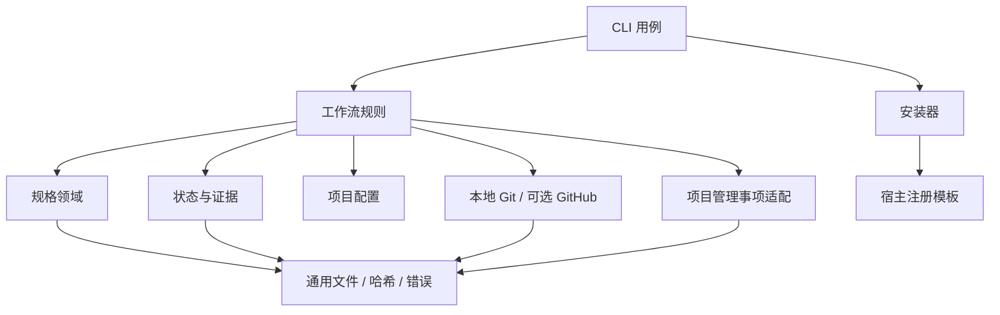

# 工程架构

## 1. 单仓库、单发布包

采用 TypeScript + ESM。目标 Node.js 22.12+，使用系统 Git。运行依赖优先采用 Node 内建能力，YAML/Markdown 使用小型解析器，避免自制不完整解析器；具体库通过实现阶段的体积、维护状态与许可证检查确定。V1 不建立 monorepo、多包发布或公共插件 SDK。

以下是实施后的目标源码结构；当前仓库并未实现这些目录。

```text
workflow/
├── bin/workflow.js
├── src/
│   ├── spec/
│   │   ├── model.ts                # 版本化文档 AST 与索引
│   │   ├── parser.ts               # 自研格式解析
│   │   ├── validate.ts             # 规则与引用检查
│   │   ├── trace.ts                # requirement/scenario/task 追踪
│   │   ├── changes.ts              # 创建、读取、列出
│   │   ├── sync.ts                 # 纯函数生成规格投影
│   │   └── archive.ts              # 事务归档的领域计划
│   ├── workflow/
│   │   ├── phases.ts               # 阶段图与门禁
│   │   ├── dispatch.ts             # 任务封装，不调用模型
│   │   ├── decisions.ts            # 有界恢复和决策记录
│   │   └── epic.ts                 # 就绪集及集成前置事实
│   ├── runtime/
│   │   ├── state.ts                # 状态快照、迁移
│   │   ├── lock.ts                 # 独占写锁与接管
│   │   ├── journal.ts              # 跨文件操作日志
│   │   ├── evidence.ts
│   │   ├── fingerprint.ts
│   │   ├── progress.ts             # 派生 Markdown
│   │   └── recovery.ts
│   ├── project/
│   │   ├── config.ts
│   │   ├── paths.ts                # 仓库、worktree、元数据定位
│   │   └── validation.ts           # 影响/CI 映射到命令计划与执行证据
│   ├── tracking/
│   │   ├── model.ts                # 平台无关事项引用与快照
│   │   ├── contract.ts             # 项目管理适配能力契约
│   │   └── github.ts               # 首个事项来源：GitHub Issues 只读
│   ├── repository/
│   │   ├── git.ts
│   │   ├── local.ts                # 本地提交与完成事实
│   │   └── github.ts               # PR/CI/合并，与事项适配分开
│   ├── hosts/{contract,codex,claude,opencode,pi}.ts
│   ├── installer/{install,upgrade,uninstall,manifest}.ts
│   ├── shared/{errors,hash,fs,process}.ts
│   └── cli/                        # 参数 → 用例服务 → 输出
├── assets/
│   ├── workflow/{SKILL,WORKFLOW}.md
│   ├── roles/                      # 角色职责单一来源
│   ├── hosts/                      # 注册/入口模板
│   └── templates/                  # 自研规格与配置模板
├── tests/{unit,contracts,integration,fixtures}/
├── examples/
└── docs/
```

## 2. 依赖方向



规格领域不 import 宿主、运行会话或 GitHub。纯 `planSync` 只接受输入文档及基线、返回投影和诊断。应用层在运行锁和事务保护下执行归档计划。工作流图只有一份；宿主只翻译入口与角色注册，不分别维护阶段规则。

CLI 不保有自己的阶段状态，不能出现与 runtime 相互矛盾的第二套 succeeded 判断。普通查询为只读；写命令经统一用例层执行锁、前置条件、journal、证据与快照。

tracking 与 repository 互不依赖，均由应用层编排；共享必要的 HTTP/认证传输工具不能把两层连接身份绑定。规格领域只接收平台无关的引用及已采纳内容，不 import GitHub/Jira 等实现。首个 tracking adapter 为 GitHub Issues，只读接入；PR/CI 仍在 repository/github。详细模型与边界见 [事项适配](15-tracking-adapters.md)。

## 3. 接入项目的目录

```text
项目根/
├── .workflow/
│   ├── config.yaml                 # 项目配置，提交
│   ├── rules.md                    # 项目长期约束，提交
│   ├── install.json                # 固定版本与管理摘要，提交
│   ├── managed/                    # 安装包生成的角色/协议/模板，提交
│   ├── runtime/                    # 固定版本本地 CLI 产物，提交
│   ├── specs/<capability>/spec.md   # 正式行为规格，提交
│   ├── changes/<change>/           # 活动变更，提交
│   ├── archive/<date>-<change>/     # 归档，提交
│   └── epics/<epic>.yaml            # 依赖图，提交
├── .agents/skills/workflow/         # 指向管理协议的薄入口，提交
├── AGENTS.md                        # 明确标记的管理区块
└── 所选宿主自己的入口文件

共享 Git common-dir/workflow/
├── identity.json                    # 逻辑项目 ID 与定位信息
├── locks/
├── runs/<change>/<run-id>/
│   ├── state.json                   # 权威机器状态
│   ├── events.jsonl                 # 审计投影
│   ├── progress.md                  # 人类视图
│   ├── evidence/
│   └── manifests/
└── transactions/                    # 归档、状态更新、安装 journal
```

默认通过 `git rev-parse --git-common-dir` 定位共享运行根。必须规范为真实绝对路径，并区别普通仓库与 linked worktree；不把 worktree 的 `.git` 文件当目录。运行记录不会随子 worktree 删除，也不会被误提交。

Git 元数据通常不会随 clone 传输，跨机器恢复需显式导出/导入证据并重查事实；V1 只承诺同一逻辑仓库的跨会话/跨 worktree 恢复。普通文件夹可做 init dry-run，但执行 local/GitHub 集成需有效 Git 仓库。

## 4. 核心契约草案

```ts
interface SpecEngine {
  parse(input: DocumentInput): ParseResult;
  validate(bundle: ChangeBundle, gate: 'draft' | 'spec' | 'integration'): Diagnostics;
  trace(bundle: ChangeBundle): TraceGraph;
  planSync(input: SyncInput): SyncPlan;
  validateArchive(input: ArchiveBundle): Diagnostics;
}
interface RuntimeStore {
  read(runId: string): RunState;
  transition(input: TransitionRequest): TransitionResult;
  resumePlan(facts: CurrentFacts): ResumePlan;
}
interface HostAdapter {
  id: string;
  planInstall(input: HostInstallInput): FilePlan;
  inspectCapabilities(input: HostEvidence): CapabilityReport;
}
```

这里只定义内部边界，不宣称稳定公共 API。宿主 adapter 无 `runAgent()` 外部进程接口；派发由主会话的原生工具完成。

四个 host adapter 都只提供安装/注册计划、原生工具映射与能力核查；不实现 Node.js Agent runner、模型 SDK 会话管理或 Agent CLI/RPC 驱动。shared/process 可执行 Git、构建和测试等确定性命令，其存在不能作为启动角色进程的通道；声明为验证命令的 Agent 启动器同样违反该边界。

活动变更门禁使用 ChangeBundle；归档后最终检查使用 ArchiveBundle（原事务、归档内容、正式规格输出及索引）。不能为了复用活动校验接口而临时伪造第二份活动目录。project/validation 生成验证计划、通过统一进程层执行所选命令并采集证据；归档事务落盘与最终集成通过为两个独立事实。

## 5. 错误与 I/O

诊断至少包括 `code/message/path/line/severity/hint`。文件变更先形成计划，执行时检查路径边界和预期原摘要，防止检查与写入间出现并发覆盖。命令用 executable + argv、`shell:false`、明确 cwd/timeout 运行，默认不继承敏感环境值到日志。

普通查询在活动事务未提交时拒绝读取混合状态，提示恢复；不能因为单文件 rename 原子就宣称多文件归档原子。详见 [状态与恢复](05-runtime.md)。
